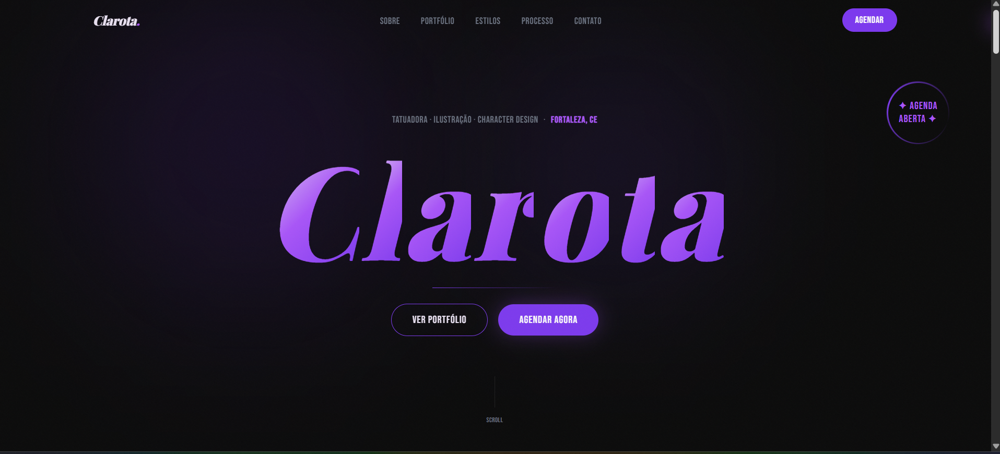

# Clarota Tattoo — Portfolio

Site de portfólio single-page para a tatuadora Clarota. Construído com Next.js 16, React 19, Tailwind CSS v4 e Framer Motion.



## Stack

- **Next.js 16** (App Router)
- **React 19**
- **TypeScript**
- **Tailwind CSS v4** — configurado via `app/(site)/globals.css` com `@theme {}`, sem `tailwind.config.js`
- **Framer Motion** — animações de entrada por seção
- **shadcn/ui + Base UI** — componentes de UI
- **Keystatic** — painel de conteúdo em `/keystatic`, sem banco (conteúdo em JSON no repo)
- **React Three Fiber + drei** — museu 3D em `/museu` (só desktop)

## Estrutura

```
app/
  (site)/
    page.tsx            # página principal — renderiza todas as seções em ordem
    museu/page.tsx      # museu 3D (desktop)
    layout.tsx          # layout raiz do site, metadados SEO
    globals.css         # tokens de design (@theme), classes utilitárias, fontes
    opengraph-image.tsx # imagem OG gerada dinamicamente
  keystatic/            # painel de conteúdo (root layout próprio, sem o CSS do site)
  api/keystatic/        # API do painel

components/
  sections/             # Hero, About, Portfolio, Styles, Testimonials, Booking, Contact, Footer
  shared/               # CursorGlow, Navbar, ScrollProgress, NoiseOverlay
  museum/               # cena 3D, câmera do tour, HUD

content/*.json          # conteúdo do site — editado pelo painel
keystatic.config.tsx    # schema do painel (campos, rótulos, validações)

lib/
  content.ts            # lê content/*.json e exporta ARTIST, CONTACT, STYLES, TESTIMONIALS, PORTFOLIO_ITEMS

public/
  portfolio/items/<slug>/image.webp  # imagens do portfólio (layout gerado pelo Keystatic)
  profile.jpg                        # foto da artista

docs/
  design-spec.md        # especificação de cores, tipografia e layout
  PAINEL.md             # setup e uso do painel de conteúdo
```

## Comandos

```bash
npm run dev      # servidor de desenvolvimento em http://localhost:3000
npm run build    # build de produção (também valida tipos TypeScript)
npm run start    # serve o build de produção
```

## Conteúdo

**Todo o conteúdo do site está em `content/*.json`** e é editado pelo painel em `/keystatic` (em dev: `http://localhost:3000/keystatic`, sem login). Nunca hardcode textos dentro dos componentes. Setup do painel em produção e guia de uso: [`docs/PAINEL.md`](./docs/PAINEL.md).

## Museu 3D

`/museu` mostra o portfólio como uma galeria 3D com tour guiado (setas/A-D, clique na obra, arrastar para olhar, Esc para a entrada). As obras vêm de `PORTFOLIO_ITEMS`, então o que entra pelo painel aparece no museu automaticamente. Em telas de toque ou estreitas a rota mostra um aviso e leva de volta ao portfólio; o botão de entrada fica escondido no celular.

## Fontes

| Classe           | Fonte              | Uso                   |
| ---------------- | ------------------ | --------------------- |
| `font-display`   | Playfair Display   | Títulos, nome no hero |
| `font-heading`   | Bebas Neue         | Labels, UI, CTAs      |
| `font-sans`      | DM Sans            | Corpo de texto        |
| `font-editorial` | Cormorant Garamond | Citações em itálico   |

## Deploy

Recomendado via [Vercel](https://vercel.com). Basta conectar o repositório. O site funciona sem variáveis de ambiente; o painel `/keystatic` só liga em produção depois de cadastrar as variáveis do GitHub App (ver [`docs/PAINEL.md`](./docs/PAINEL.md) e `.env.example`).

## Licença

[CC BY-NC 4.0](./LICENSE) — uso não comercial permitido com atribuição.
